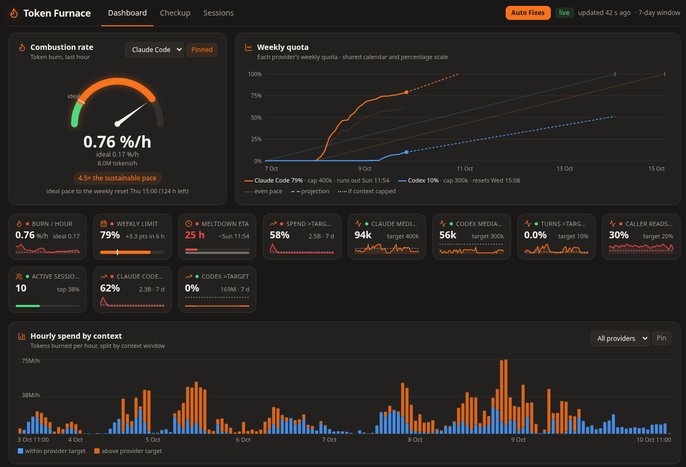
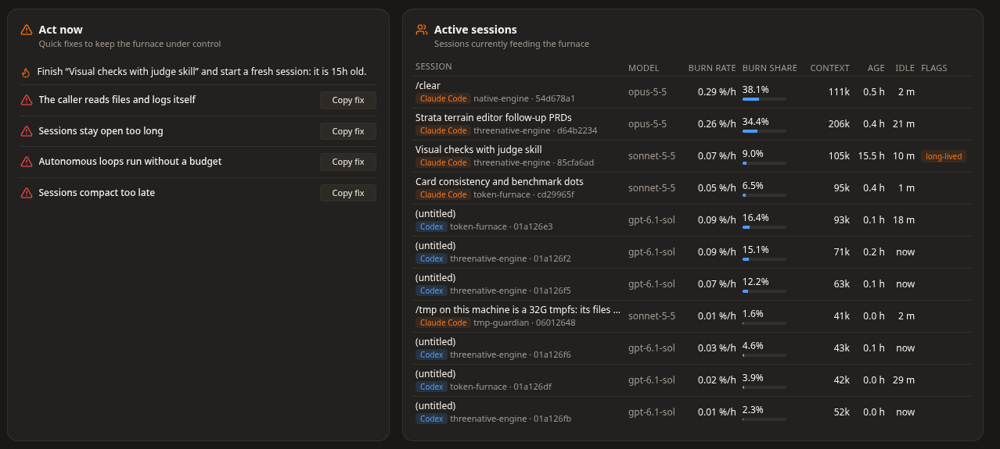
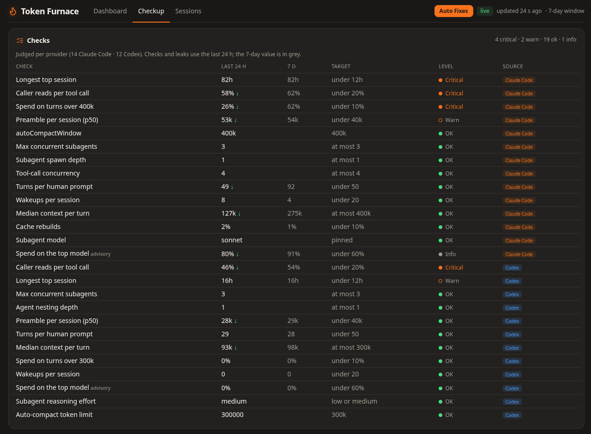

# token-furnace

[](https://www.npmjs.com/package/token-furnace)
[](https://www.npmjs.com/package/token-furnace)
[](LICENSE)

Where the token budget actually went. `token-furnace` reads your local Claude Code, Codex and OpenCode
transcripts, finds token leaks, and shows the result in your terminal, as JSON for agents, and in a
local dashboard. Transcript data never leaves your machine.



Each card has a target. A red dot means the target is missed and a green dot means it is met.

| Act now and active sessions | Checkup |
| --- | --- |
|  |  |

## Quick start

Requires **Node.js 22.13 or newer** and local Claude Code, Codex or OpenCode transcripts.

The CLI and local dashboard use Node.js APIs on Linux, macOS and Windows. Setup and
configuration repair use the OS home directory when `HOME` is unset; custom agent directories
are respected. Windows setup uses directory junctions on NTFS. Use `setup --rollback` to restore
backups on any platform; the generated `restore.sh` additionally requires Bash.

Platform CI is configured to run the tests and installed-package smoke checks on Linux, Windows and macOS,
with Node 22.13 and 24. Live agent hooks and macOS Keychain access need separate verification.

Run it without installing:

```sh
npx token-furnace@latest
```

Open the live dashboard:

```sh
npx token-furnace@latest serve
```

Visit **http://127.0.0.1:8765**. The first scan measures local usage; later scans reuse a metadata cache.
Choose Claude Code, Codex or OpenCode independently for each chart, and pin a selection to remember it on reload.

Export a report for scripts or sharing:

```sh
npx token-furnace@latest --json --no-plan-usage
npx token-furnace@latest --html report.html
```

Reports include session titles and file paths. Review an exported report before sharing it.
With no transcripts, the CLI exits 1; run `npx token-furnace@latest --list-sources` to see where it looks.

Or install it globally:

```sh
npm install -g token-furnace
```

## Commands

| Command | Result |
|---|---|
| `token-furnace [days] [--source claude\|codex\|opencode]` | Ranked verdict on stdout. `days` defaults to 7. Exits 1 on leaks or no data. |
| `token-furnace --full` | Full text report. |
| `token-furnace --json` | The `Report` JSON on stdout, for agents and scripts. Exits 0 even when leaks are present. |
| `token-furnace --html <path>` | Writes a static HTML report with the report JSON inlined. It does not change the exit code. |
| `token-furnace --list-sources` | Each agent, its path, and its transcript count. |
| `token-furnace serve [--port 8765]` | Live dashboard on `http://127.0.0.1:<port>`. It serves the last scan and refreshes it in the background. |
| `token-furnace setup [--apply] [--verify] [--rollback] [--aggressive]` | Installer. Dry run unless `--apply`. |
| `token-furnace fix-config` | Repairs context and worker settings; backs up changed files first. Optional `--include-depth`. |
| `token-furnace hook churn` | Claude Code PostToolUse churn hook. Reads the payload on stdin. Never blocks. |
| `token-furnace budgets status` | Prints the shared budget and emergency-stop state used by the dashboard and hooks. |
| `token-furnace budgets stop --provider <id>` | Previews a provider stop. Add `--confirm`; add `--force --force-confirm` only after reviewing collateral scope. |
| `token-furnace budgets unlock --provider <id> --confirm` | Unlocks one exact provider, model, or source latch. It does not restart old work. |
| `token-furnace budgets enable --confirm` | Installs backed-up local budget adapters where the installed source supports a safe configuration path. |

Options:

- `--weekly-budget <M>` — weekly budget in millions of weighted tokens. `TOKEN_FURNACE_WEEKLY_BUDGET`
  sets the same value.
- `--no-cache` — parse every file and write no cache.
- `--no-plan-usage` — never fetch Anthropic or OpenCode Go usage. A saved reading is still used.
- `-h`, `--help` — usage text.

## OpenCode

Current SQLite sessions are read from `$XDG_DATA_HOME/opencode/opencode.db` (default
`~/.local/share/opencode/opencode.db`). Set `OPENCODE_DATA_DIR` to override that directory.
The database is opened read-only, including live WAL updates. Legacy JSON session stores
are not supported. Assistant message usage counts once; step-finish usage is not added again.

OpenCode Go reads the local `auth.json` entry for `opencode-go` (or `OPENCODE_API_KEY`)
and fetches the real weekly utilization and reset from `https://opencode.ai/zen/go/v1/usage`.
The weekly dashboard uses that reading to calibrate local weighted tokens; burn projections
are estimates, not billed dollars. OpenCode sessions from other providers are included in
local totals; only `opencode-go` sessions calibrate the Go quota. The 5-hour and monthly meters
are not displayed. Unknown models keep the existing unpriced-model warning.
No OpenCode configuration is changed by Auto Fixes.

## Context targets

The analysis targets context sizes of **Claude Code 400k** and
**Codex 300k**, with a **128k OpenCode diagnostic target** (not a model context limit). Checkup, session flags, dashboard KPIs, hourly spend charts, benchmark estimates,
and configuration repair all use these values. A turn exactly at its provider target is within
target. Mixed-provider charts compare each turn against its own provider target.

## Auto Fixes

In the live dashboard, click **Auto Fixes** in the page header, review the changes, and select
**Back up and apply**. Cancel closes the modal without changing files.

The **Auto Fixes** button opens a checklist with every repair checked by default. Uncheck any
setting to leave it unchanged; only selected repairs are applied. Backups are always made first.
The CLI defaults still exclude depth limits unless `--include-depth` is supplied.
Both providers get a concurrent worker cap of 3; Claude gets tool concurrency capped at 4
and Sonnet workers if no worker model is pinned. Codex worker reasoning is set to medium
unless already medium or lower. Existing lower caps and pinned models are preserved.
Use `token-furnace fix-config --include-depth` or keep the modal depth checkboxes selected to also cap
nesting at 1. This is optional because some agent versions may reject it or block spawning.
Session age, caller reads, wakeups and unbounded loops require workflow changes; configuration
repairs cannot rewrite those historical measurements.

Run `token-furnace fix-config` to set Claude Code's `autoCompactWindow` to `400000` and
Codex's `model_auto_compact_token_limit` to `300000`. Checks warn when these settings differ.
The command respects `CLAUDE_CONFIG_DIR` and `CODEX_HOME`, preserves unrelated settings,
and saves each existing changed file beside the original as `.token-furnace-backup`
(with a numbered suffix when needed). No backup is needed for a newly created file.
Invalid or unsupported configuration exits 1 before editing either file. Repeated runs make
no changes once targets match. Restore by copying the printed backup path over its original.
Restart agents after repair. A shell `CLAUDE_CODE_AUTO_COMPACT_WINDOW` override must be unset
in the shell; the command reports it when present.

## Setup and hook

`token-furnace setup` prints the planned changes and changes no file. Add `--apply` to write them.
Existing values and comments are preserved. Invalid or unsupported Codex settings are skipped
with a warning.
`--verify` checks an existing install and exits 1 on any failure. `--rollback` restores the most
recent backup. `--aggressive` also sets the flagged-risky subagent spawn depth; verify that
subagents still spawn after any Claude Code upgrade.

`token-furnace hook churn` is the PostToolUse hook. It counts edits per file per session and
injects an escalation prompt at the 4th, 7th, and 10th edit.

## Budgets and emergency stops

Open the live dashboard's **Budgets** tab at `#budgets`. New installs start **Off**, which only
observes usage. **Auto** derives percentage-points per hour from an authoritative quota and its
reset; **Manual** accepts a positive weighted-token pace or a cumulative weighted-token allowance
with an explicit deadline. Saving a policy does not clear measured usage, reservations, or
emergency latches. Use **Enable enforcement** only after reviewing the adapter preview; native
coverage remains qualification-gated.

Provider and model stops are separate from budgets. A stop writes its durable latch before asking a
verified same-user adapter to cancel work. Preview, confirmation, native outcome, force escalation,
and unlock all use the same state as the CLI. Durable control ownership/results and budget state live
under `$XDG_STATE_HOME/token-furnace/` (or `$HOME/.local/state/token-furnace/`); policy settings live under
`$XDG_CONFIG_HOME/token-furnace/` (or `$HOME/.config/token-furnace/`).

Native qualification must use dedicated disposable homes and authenticated upstreams. Run
`npm run qualify:budgets -- --sources claude,codex,opencode` only with those homes configured via
`TOKEN_FURNACE_QUALIFY_CLAUDE_HOME`, `TOKEN_FURNACE_QUALIFY_CODEX_HOME`, and
`TOKEN_FURNACE_QUALIFY_OPENCODE_DATA_DIR`; missing access is reported as **BLOCKED**, never PASS.

## Privacy

- Transcript data stays on this machine. The tool sends no telemetry.
- The local cache stores metadata only: session titles, token counts, timestamps, models, tool
  names, and file paths. It never stores message text.
- Plan usage can contact Anthropic with a local Claude Code login, or the OpenCode Go usage endpoint with a local Go key. Keys go only to their own provider; `--no-plan-usage` disables network calls.
- The server binds to `127.0.0.1` only. It rejects a `Host` header that is not loopback.

## Cache

The cache lives at:

- `$XDG_CACHE_HOME/token-furnace/` when `XDG_CACHE_HOME` is set.
- `$HOME/.cache/token-furnace/` otherwise.

It holds `cache.sqlite` (parsed sessions) and `usage.json` (the last plan reading). To clear it:

```
rm -rf "${XDG_CACHE_HOME:-$HOME/.cache}/token-furnace"
```

Use `--no-cache` to skip the cache for one run. The cache is disposable; a schema change rebuilds it.

## Progress and workers

A terminal gets a redrawn progress line on stderr. Set `TOKEN_FURNACE_WORKERS=0` to parse on the
main thread, or a positive number to set the worker count.

## Exit codes

- `0` — no leaks found. The `--json` and `--full` reports also exit 0 when leaks are present.
- `1` — leaks found, or no transcripts found.
- `2` — a rejected value for `days`, `--source`, or `--port`.
- `75` — native budget qualification is blocked because a dedicated authenticated target is unavailable.

An unknown option does not exit 2. `node:util` `parseArgs` throws, so that run exits 1 with a stack
trace.

## Development and contributing

Bug reports and focused pull requests are welcome. For a bug, include your Node.js version,
the command you ran, and a redacted error or minimal transcript example. Keep credentials and
private transcript content out of issues.

```sh
git clone https://github.com/jonit-dev/token-furnace.git
cd token-furnace
npm ci
npm run typecheck
npm test
npm run smoke
```

`npm test` builds the CLI and dashboard before running the suite. `npm run smoke` packs and installs
the package into a temporary project, then checks the installed CLI, HTML export and live server
against synthetic transcripts. `npm pack` and `npm publish` rebuild the distributable automatically.
The dashboard is self-contained: no CDN scripts, fonts or styles are needed.

[Report a bug](https://github.com/jonit-dev/token-furnace/issues) ·
[Browse the source](https://github.com/jonit-dev/token-furnace)

## License

[MIT](LICENSE) © Joao Paulo Furtado
