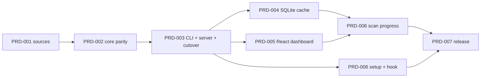

# Epic: npx restructure

Move token-furnace from Python scripts to one Node/TypeScript npm package. The package has a CLI, a local SQLite cache, an Express server, and a React dashboard.

- Architecture: [architecture.md](architecture.md)
- Data contracts and cache schema: [schema.md](schema.md)
- Functional requirements: [functional-requirements.md](functional-requirements.md)

## Execution order

Do the PRDs in this order. PRDs in the same wave can run in parallel.

| Wave | PRD | Title | Depends on | Priority |
|---|---|---|---|---|
| 1 | [PRD-001](PRD-001-scaffold-and-sources.md) | Scaffold the package and port the transcript sources | None | P1 |
| 2 | [PRD-002](PRD-002-analysis-core-parity.md) | Port the analysis core with parity against Python | PRD-001 | P1 |
| 3 | [PRD-003](PRD-003-cli-server-cutover.md) | CLI, Express server, and cutover from `burn.py` | PRD-002 | P1 |
| 4 | [PRD-004](PRD-004-sqlite-cache.md) | SQLite cache for incremental scans | PRD-003 | P2 |
| 4 | [PRD-005](PRD-005-react-dashboard.md) | React dashboard replaces `dashboard.html` | PRD-003 | P2 |
| 4 | [PRD-006](PRD-006-setup-and-hook-port.md) | Port the installer and the churn hook | PRD-003 | P2 |
| 5 | [PRD-008](PRD-008-scan-progress.md) | Scan progress and a cold start that never looks frozen | PRD-004, PRD-005 | P1 |
| 6 | [PRD-007](PRD-007-package-and-release.md) | Package smoke test and release | PRD-006, PRD-008 | P2 |

## Why this order

- PRD-002 needs the Python code as the reference for parity. Python stays until PRD-003 replaces every caller.
- PRD-003 serves the old `dashboard.html` from Express, because that page already reads `/api/report`. The live report keeps working during the gap before PRD-005.
- PRD-004, PRD-005, and PRD-006 touch different directories (`src/repo/`, `web/`, `src/setup/`). They can run at the same time.
- PRD-007 publishes. The publish step needs João.

## Done when

- `npx token-furnace` works on a clean machine with Node 22.13 or later, and with no Python or `jq`.
- The repository contains no Python files.
