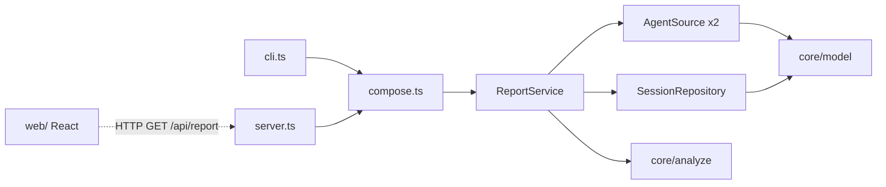

# Architecture — npx restructure

**Status:** PROPOSED
**Date:** 2026-10-09

## Goal

Ship `token-furnace` as one npm package. A developer runs `npx token-furnace` on their own machine. The tool reads local Claude Code and Codex transcripts, finds token leaks, and shows the result in the terminal, as JSON for agents, and in a local React dashboard. Transcript data never leaves the machine.

## Current state (before this epic)

| Part | Today | Problem |
|---|---|---|
| `scripts/burn.py` (1507 lines) | Parsing, config checks, analysis, rendering, HTTP server, and CLI in one file | Hard to test and extend. Needs Python 3. |
| `scripts/dashboard.html` (737 lines) | React 18 + htm + Tailwind from CDNs, no build. `render_html()` replaces `/*REPORT*/null` with JSON. | No build, no types, CDN dependency. |
| `scripts/doctor` | Shell wrapper. Starts `burn.py --serve 8765`, then runs `burn.py --doctor --html`. | Python only. |
| `scripts/setup-agents.sh` | Installer. Needs `jq` and Python 3.11+. | Two more runtimes. |
| `scripts/escalate-on-churn.py` | PostToolUse hook. Counts edits per file. | Python only. |

## Target layout

One package, not a monorepo. Add workspaces only when a second package ships.

```
package.json            bin: token-furnace -> dist/cli.js ; engines: node >=22.13
src/
  core/                 pure logic, no I/O
    model.ts            Turn, Session, Finding, Report types (see schema.md)
    analyze/            flags.ts  baseline.ts  config-checks.ts  report.ts (buildReport)
  sources/              read-only adapters for agent data on disk
    agent-source.ts     AgentSource interface
    claude.ts           ClaudeSource  (~/.claude/projects/*/*.jsonl, settings.json, MEMORY.md)
    codex.ts            CodexSource   (~/.codex/sessions/**/rollout-*.jsonl, config.toml)
  repo/
    session-repo.ts     SessionRepository interface
    memory-repo.ts      MemorySessionRepository  (tests, --no-cache)
    sqlite-repo.ts      SqliteSessionRepository  (node:sqlite cache)
  services/
    report-service.ts   ReportService: refresh() + getReport(days, source)
    usage-client.ts     plan usage call to api.anthropic.com (when a login exists; `--no-plan-usage` disables)
  compose.ts            composition root: builds every object once
  cli.ts                node:util parseArgs -> commands
  server.ts             Express 5: /api/report + static dashboard
  setup/                setup command and churn hook (PRD-006)
web/                    Vite + React + Tailwind + Zustand -> dist/web/index.html
test/fixtures/          small Claude and Codex transcripts
```

## Layers and dependency rule

Arrows point to what a module may import. `core/` imports nothing outside `core/`.



## Repository pattern and composition

Two boundaries have real alternative implementations, so they get an interface:

- **`AgentSource`** — one implementation per agent: `ClaudeSource`, `CodexSource`. A third agent is a third class, with no change to the analysis code.
- **`SessionRepository`** — `MemorySessionRepository` for tests and `--no-cache`, and `SqliteSessionRepository` for the cache.

Composition uses plain constructor injection. `compose.ts` is the only place that calls `new`:

```ts
export function compose(env = process.env) {
  const sources = [new ClaudeSource(env), new CodexSource(env)];
  const repo = env.TOKEN_FURNACE_NO_CACHE ? new MemorySessionRepository() : new SqliteSessionRepository(cachePath(env));
  return { reports: new ReportService(sources, repo) };
}
```

Tests call `new ReportService([fixtureSource], new MemorySessionRepository())` directly.

**No DI container (tsyringe).** See Decisions. The object graph has about six objects, and one function builds them all.

## Data flow

1. `ReportService.refresh()` asks each `AgentSource` for its transcript files with `path`, `mtime`, and `size`.
2. The repository returns the files that changed since the last scan.
3. Only those files are parsed into `Turn` rows and stored.
4. `getReport(days, source)` loads turns and config from the repository and source, then calls the pure `buildReport()`.
5. The CLI prints the verdict or JSON. The server returns the same `Report` JSON from `/api/report`.

## Entry points

| Command | Result |
|---|---|
| `token-furnace [days] [--source claude\|codex]` | Ranked verdict on stdout. Exit 1 on leaks or no data (same as `burn.py --doctor`). |
| `token-furnace --full` | Full text report (old `burn.py` default output). |
| `token-furnace --list-sources` | Each agent, its path, and its transcript count. |
| `--weekly-budget M`, `--no-cache`, `--no-plan-usage` | Burn goal, skip the cache (PRD-004), `--no-plan-usage` disables the plan-usage network call. |
| `token-furnace --json` | `Report` JSON on stdout, for agents and scripts. |
| `token-furnace --html <path>` | Writes a static report: one HTML file with the JSON inlined. |
| `token-furnace serve [--port 8765]` | Express on `127.0.0.1`. Opens the dashboard. |
| `token-furnace setup [--apply]` | Installer. Dry run unless `--apply` (PRD-006). |
| `token-furnace hook churn` | PostToolUse churn hook (PRD-006). |

## Security boundaries

- The server binds to `127.0.0.1` only.
- The server rejects requests whose `Host` header is not `127.0.0.1:<port>` or `localhost:<port>`. This blocks DNS-rebinding pages from reading the report. The server sends no CORS headers.
- Transcript lines are untrusted JSON. A source skips a malformed line and counts it. A bad line never stops the scan.
- The cache stores token counts, timestamps, models, tool names, and file paths. It never stores message text.
- One network call: plan usage, to `api.anthropic.com` only. It runs when a Claude login exists on the machine, at most once a minute and only when the saved reading is over 5 minutes old. `--no-plan-usage` turns it off.

## Tech stack

| Concern | Choice | Reason |
|---|---|---|
| Runtime | Node `>=22.13` | First version with unflagged `node:sqlite`. Node 20 reached end of life in April 2026. |
| Language | TypeScript, `strict` | Types for the report contract shared by the server and the web app. |
| CLI args | `node:util` `parseArgs` | Stdlib. No dependency. |
| HTTP | Express 5 | Known by the team. About 3 routes. |
| Local DB | `node:sqlite` | Built in, no native build during `npx` install. |
| Bundle | tsup (CLI and server), Vite (web) | Fast, standard. |
| Frontend | React, Tailwind, Zustand | Zustand holds UI state only. Report data comes from `/api/report`. |
| Tests | Vitest | One runner for `src/` and `web/`. |

Runtime dependencies: `express`, `routing-controllers`, `reflect-metadata` (and the peers `class-transformer`, `class-validator`). React, Tailwind, and Zustand are build-time dependencies that are bundled into `dist/web`.

## Not in scope

- **MCP server.** Agents use `token-furnace --json`. MCP tool schemas load into every agent session and use context tokens on each turn. Add `mcp.ts` (about 50 lines over `ReportService`) when a client without a shell needs access.
- **Team aggregation, hosted dashboard, accounts.**
- **Migrations.** The cache is disposable. A schema change deletes and rebuilds it.

## Decisions

- 2026-10-09 (João): Local-only tool for developers. Data stays on the machine.
- 2026-10-09 (João): Read-only agent surface. Config changes go through `setup` only.
- 2026-10-09 (João): Node + TypeScript. Core + thin adapters. No decorator controllers, no NestJS.
- 2026-10-09 (João): Frontend React + Tailwind + Zustand replaces `dashboard.html`.
- 2026-10-09 (João): Full TypeScript port with test parity, then delete the Python.
- 2026-10-09 (Claude, delegated by João): CLI with `--json` instead of MCP for agent access. Reason: MCP schemas cost context in every session.
- 2026-10-09 (João): Local DB, keep it simple. Chosen: `node:sqlite` as a disposable cache. MySQL needs a running server that `npx` users do not have.
- 2026-10-09 (João): Repository pattern and composition. Chosen: interfaces at two boundaries plus manual constructor injection. tsyringe was not chosen: it needs `reflect-metadata` and `emitDecoratorMetadata`. esbuild (used by tsup and Vite) does not emit decorator metadata, so injection fails at runtime in the bundled npx build.
- 2026-10-09 (Claude): The plan-usage network call becomes opt-in (`--plan-usage`). Reason: `SKILL.md` says "no network", but `plan_week()` sends the OAuth token on every run.
- 2026-10-09 (João): The product, package, CLI binary, and folder name is `token-furnace`. It matches `SKILL.md` and the existing `~/.cache/token-furnace` cache directory.
- 2026-10-09 (João): The plan-usage call is on by default when a login exists. The opt-in made the dashboard ignore the subscription and show tokens/h. Supersedes the entry above.
- 2026-10-09 (João): HTTP routes use `routing-controllers` on Express, never a vanilla router. Controllers are classes in `src/server.ts`, and the host guard is a `@Middleware`. Supersedes NFR-1's "express only". `tsconfig.json` sets `experimentalDecorators`.
